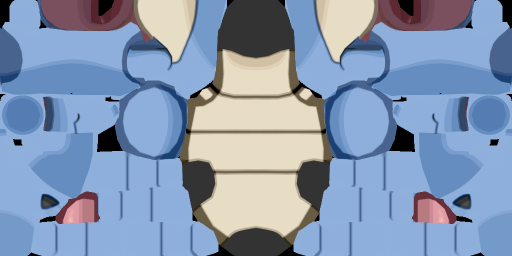
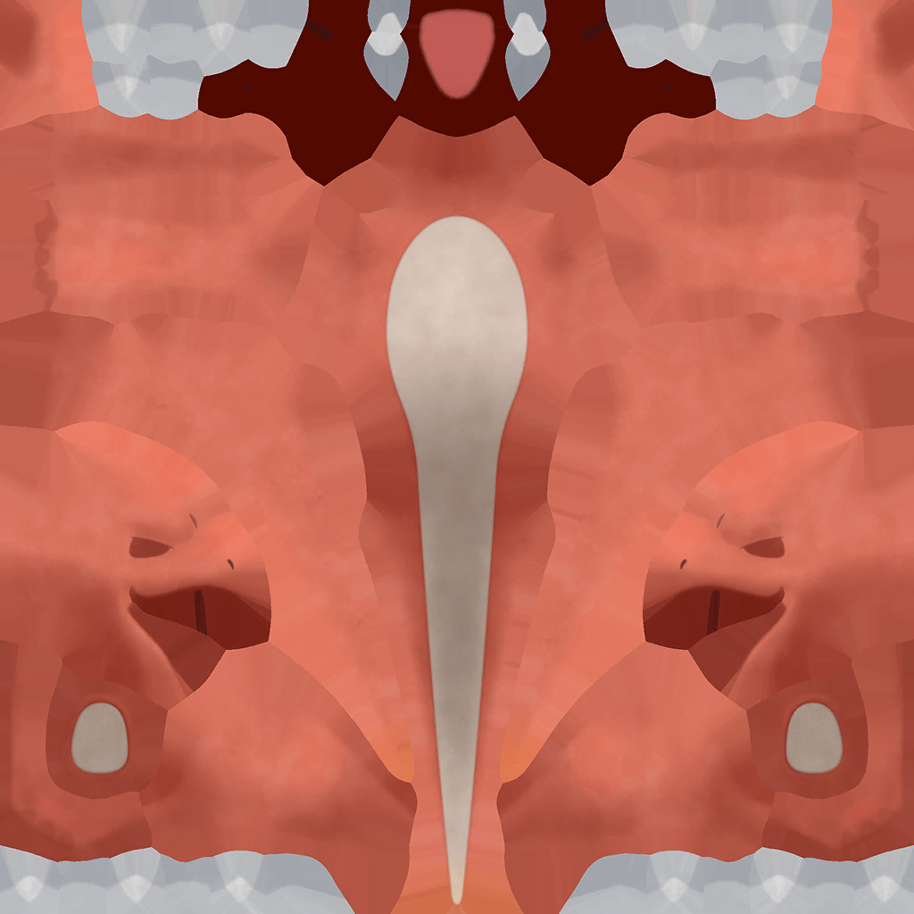
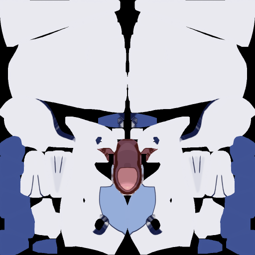
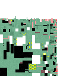
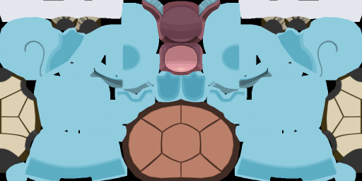
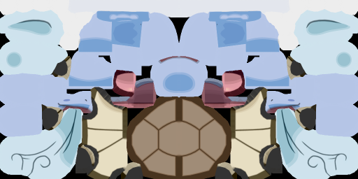

# Valcom

### Catch the creature. Resist the corruption. Master the rift.

**An asymmetric multiplayer creature-catching game built with Unity.**

------------------------------------------------------------------------

## About the Game

**Valcom** is a two-player game where each player has a different
role. The **Tamer** explores arenas and attempts to catch creatures,
while the **Warden** protects them by spending energy to corrupt
creatures or trigger environmental hazards.

A clean catch earns a higher score. But if the Warden corrupts a
creature at the right moment, the capture attempt is interrupted and a
short battle begins.

> **Current project status:** Early setup and asset organization.
> Gameplay code has not been implemented yet.

## Gameplay

### The Tamer

-   Explore the arena and approach a creature.
-   Attempt a timing-based catch.
-   Catch the creature cleanly for a higher score.
-   Fight back if the Warden corrupts the creature during a capture
    attempt.

### The Warden

-   Use a separate control interface to monitor the match.
-   Spend a recharging energy pool on corruption and hazards.
-   Disrupt captures by turning creatures hostile.
-   Use abilities strategically because each action has an energy cost.

### Round Flow

1.  Two players join the same match.
2.  The Tamer searches for a creature and starts a catch attempt.
3.  The Warden may use corruption or an environmental hazard.
4.  Corruption can trigger a short turn-based battle.
5.  The round is scored based on catch quality and remaining time.
6.  Players switch roles for the next round.

## Characters & Maps

The project has **14 character assets** and **3 maps** — all ready.

| Asset Type | Count |
|---|---|
| Creature / Agent 3D models | **14** |
| Maps / arenas | **3** ✅ |

---

### 🐉 Creature & Agent Roster

All characters are stored under `Game/Assets/Characters/`. `.glb` and `.gltf` files import directly into Unity.

#### Pokémon Creatures

| # | Creature | Type | Format | Texture Preview |
|---|----------|------|--------|-----------------|
| 1 | **Blastoise** | Water 💧 | `.zip` (3DS/FBX) |  |
| 2 | **Bulbasaur** | Grass/Poison 🌿 | `.glb` | — |
| 3 | **Charizard** | Fire/Flying 🔥 | `.glb` | — |
| 4 | **Charmeleon** | Fire 🔥 | `.fbx` |  |
| 5 | **Ivysaur** | Grass/Poison 🌿 | `.glb` | — |
| 6 | **Lugia** | Psychic/Flying 🌀 | `.zip` (3DS/FBX) |  |
| 7 | **Rayquaza** | Dragon/Flying ⚡ | `.gltf` |  |
| 8 | **Squirtle** | Water 💧 | `.zip` (3DS/FBX) |  |
| 9 | **Venusaur** | Grass/Poison 🌿 | `.glb` | — |
| 10 | **Wartortle** | Water 💧 | `.zip` (3DS/FBX) |  |

#### Valorant Agents

| # | Agent | Role | Format |
|---|-------|------|--------|
| 11 | **Clove** | Controller 💜 | `.glb` |
| 12 | **Gekko** | Initiator 🟢 | `.glb` |
| 13 | **Reyna** | Duelist 🔴 | `.glb` |
| 14 | **Tejo** | Initiator 🟡 | `.glb` |

> **Unity import:** `.glb` / `.gltf` drag-and-drop directly into Unity. For `.zip` archives, extract first and import the inner FBX. Apply textures from each character's `/textures/` subfolder as the **Albedo** on the material.

**Prop:**
- 🔵 **Poke Ball** — `.glb` (`poke_ball.glb`) — ready to use as an in-game capture prop.

---

### 🗺️ Maps / Arenas

All 3 maps are ready as Blender scenes.

| Stage | Map | File | Format | Status |
|-------|-----|------|--------|--------|
| Stage 1 | **Map 1** | `map 1.blend` | Blender scene | ✅ Ready |
| Stage 2 | **Map 2** | `map2.blend` | Blender scene | ✅ Ready |
| Stage 3 | **Map 3** | `map3.blend` | Blender scene | ✅ Ready |

**To use in Unity:** Open each `.blend` in Blender → **File → Export → FBX** → save to `Game/Assets/Maps/` → import the `.fbx` into Unity and set up materials in the inspector.

## Planned Features

-   **Asymmetric multiplayer:** Tamer and Warden have different roles
    and interfaces.
-   **Timing-based catching:** A timing challenge determines catch
    quality.
-   **Creature corruption:** The Warden can interrupt a catch and make a
    creature hostile.
-   **Short turn-based battles:** Planned three-move battle system:
    Quick, Dodge, and Pacify.
-   **Environmental hazards:** Locked gate, patrol turret, and
    collapsing bridge.
-   **Recharging energy:** Warden abilities share a limited energy pool.
-   **Three maps:** Difficulty increases across the three stages.
-   **Role switching:** Players swap roles between rounds.
-   **Timer and scoring:** Clean catches, battled catches, and remaining
    time contribute to the score.
-   **Results screen:** Planned summary of score and catch outcomes.

## Technology Stack

  -----------------------------------------------------------------------
  Technology                          Planned use
  ----------------------------------- -----------------------------------
  **Unity**                           Game engine, scenes, arenas, and
                                      gameplay

  **C#**                              Gameplay logic and UI behavior

  **Photon PUN 2**                    Multiplayer rooms and event
                                      communication

  **Unity UI**                        Capture challenge, Warden controls,
                                      timer, energy meter, and results
  -----------------------------------------------------------------------

## Planned Multiplayer Design

The game plan proposes two players joining the same Photon room,
typically on separate computers.

-   **Tamer client:** Displays the 3D arena and Tamer gameplay.
-   **Warden client:** Displays a separate control panel.
-   **Room code:** Allows both players to join the same match.
-   **Network events:** Planned communication for corruption, hazards,
    catch results, battle transitions, and role changes.
-   **Position display:** A low-frequency position update may help the
    Warden see the Tamer's approximate location.

Multiplayer is part of the design plan and has not been verified as
implemented.

## Getting Started

The project is currently being organized. Once the Unity project is
created or confirmed:

1.  Open the Unity project through Unity Hub.
2.  Use the Unity Editor version intended for the project.
3.  Confirm that the character and map assets import correctly.
4.  Add the Photon PUN 2 package and configure an App ID when
    multiplayer development begins.
5.  Test networking with two clients before building gameplay systems
    that depend on it.
